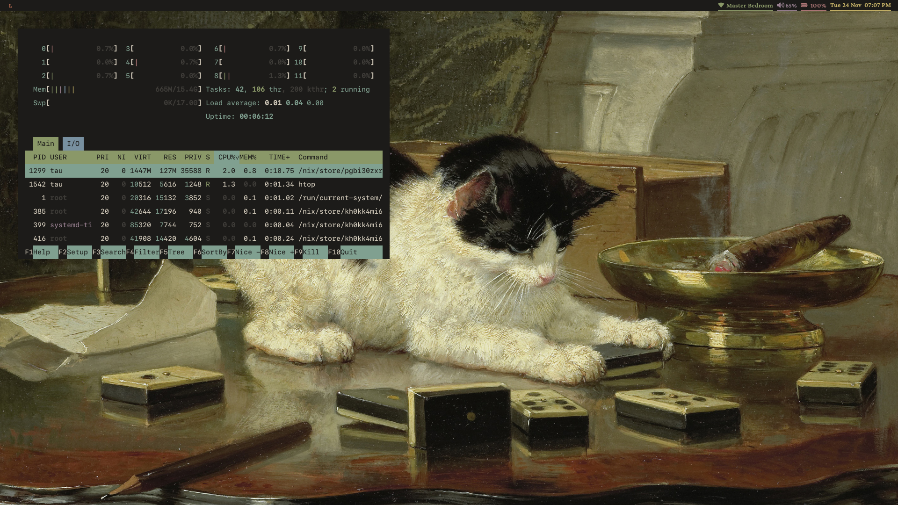

# <p align="center"> NixOS </p>

<p align="center"> Always a work in progress... </p>

<p align="center">
    
</p>

## 1.0 Install
1. Install NixOS (no desktop).
2. Connect to internet via ***nmtui***.
3. Install git temporarily via ***nix-shell***.
```bash
nix-shell -p git
```
4. Clone Repo.
```bash
git clone https://github.com/tfqdawg/.nixosbtw.git
```
5. Replace ***hardware-configuration.nix*** with system generated one.
```bash
# Replace $USER with username
cp /etc/nixos/hardware-configuration.nix /home/$USER/.nixosbtw/system/hardware-configuration.nix
```
6. Rebuild system using,
```bash
sudo nixos-rebuild switch --flake .#$USERNAME
```
<br>

## 2.0 Extras
```bash
# add flathub remote
flatpak remote-add --if-not-exists flathub https://dl.flathub.org/repo/flathub.flatpakrepo
```
