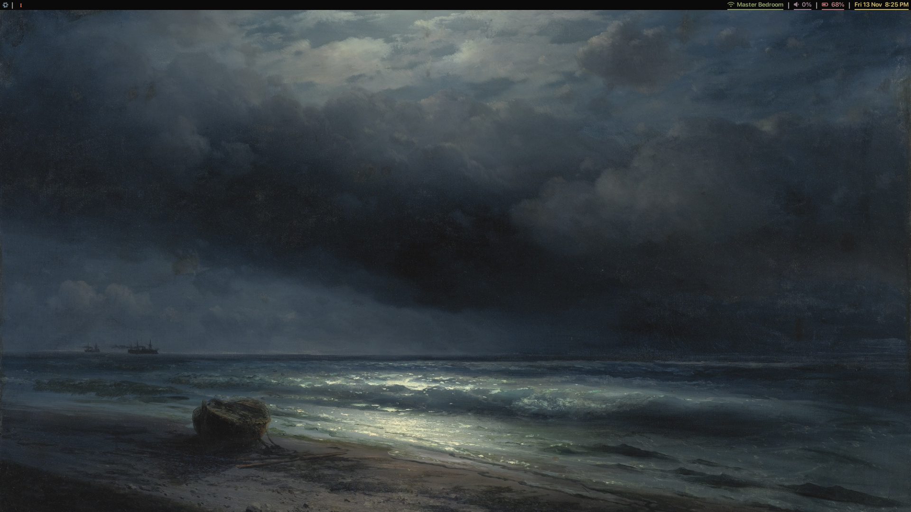

## <p align="center"> NixOS </p>

<p align="center">
    
</p>

### 1.0 Install.

1. Install NixOS (no desktop).
2. Connect to internet via `nmtui`.
3. Install git & neovim temporarily via `nix-shell`.
```bash
nix-shell -p git neovim
```

4. Clone Repo.
```bash
git clone https://github.com/tfqdawg/.nixosbtw.git
```

5. Replace generated `hardware-configuration.nix` to flake `system/` directory **(IMPORTANT!)**.
```bash
# Replace $USER with username
cp /etc/nixos/hardware-configuration.nix /home/$USER/.nixosbtw/system/hardware-configuration.nix
```

6. Disable import for `./nixvim` in `~/.nixosbtw/home/default.nix`.
7. Disable import for `./unfree.nix` in `~/.nixosbtw/system/default.nix`.
8. Rebuild system using `sudo nixos-rebuild switch --flake .#USERNAME`.
9. Re-enable imports after system is successfully installed.

### 2.0 Flatpak.
```bash
# flathub remote
flatpak remote-add --if-not-exists flathub https://dl.flathub.org/repo/flathub.flatpakrepo

# apps
flatpak install flathub -y \
  io.gitlab.librewolf-community \
  moe.launcher.an-anime-game-launcher
```
